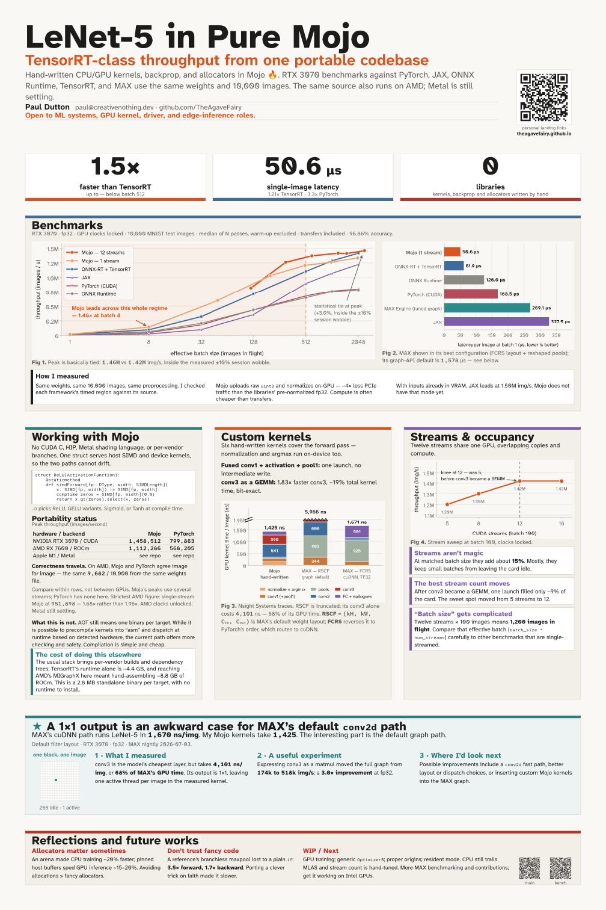

# LeNet5Mojo: LeNet-5 from Scratch in Mojo🔥

A high-performance LeNet-5 Convolutional Neural Network built entirely from scratch in [Mojo🔥](https://www.modular.com/mojo) with custom CPU and GPU kernels — featuring compile-time swappable activation functions, custom arena allocators, and the Modular/MAX ecosystem throughout.

## 📄 Project Poster

**The quickest way into this project is the one-page poster: [`poster/poster.pdf`](poster/poster.pdf).** It covers the benchmarks, kernel design, portability results, and MAX findings.

[](poster/poster.pdf)

*Click the image for the full-resolution vector PDF. Typst source and figure scripts are in [`poster/`](poster/).*

## Project Motivation

- **Learn CNNs from first principles** — every component hand-rolled: forward pass, backpropagation, weight updates, cross-entropy loss, softmax
- **Explore the Modular/MAX ecosystem** — systems programming for AI, using `layout` for compile-time tensor shapes and `std.gpu` for GPU kernel dispatch
- **Build custom GPU kernels** without CUDA C, PTX, or external ML libraries
- **Custom memory management** — bump arena allocators on both CPU and GPU, pre-allocating one slab per run and sub-allocating into it
- **Compile-time activation functions** — switch between ReLU, GELU, GELUTanh, GELUFast, Sigmoid, and Tanh with a compiler flag; no runtime branching

## Performance Highlights

Streaming MNIST inference on an RTX 3070 (fp32, GPU clocks locked), full 10,000-image test set:

- **Up to 1.48× faster than TensorRT below batch 512** (batch 8: 141k vs 95k img/s), and **lowest single-image latency** measured: **50.6 µs** vs 61.0 µs for TensorRT (1.21×) and 168.5 µs for PyTorch (3.3×)
- **Tied with TensorRT at peak** — 1.46M vs 1.42M img/s; the +3.0% margin is inside the ±10% session-to-session variance, so it is not claimed as a win. Clear of JAX/XLA (1.22M), PyTorch (0.80M), and ONNX Runtime CUDA (0.78M)
- Even **single-stream** (no copy/compute overlap), the custom kernels hit **1.33M img/s** — ahead of every framework except TensorRT
- **Portable**: the same source runs on an **AMD RX 7600** at 1.11M img/s, 1.96× PyTorch-ROCm (1.68× single-stream), with Mojo and PyTorch agreeing image-for-image. Apple Metal is blocked on a compiler bug
- **Matched accuracy** — 96.86% (9686/10000) on NVIDIA, identical to the PyTorch and JAX reference models
- **Custom GPU kernels** written in pure Mojo — no CUDA C, HIP, cuDNN, or BLAS

Two optimizations drove the latest jump — **fusing conv1 + activation + pool1 into one kernel** (layer1 never touches global memory) and **recasting conv3 as a batched GEMM**. See [Key GPU Optimizations](#key-gpu-optimizations) for the details.

*With inputs already resident in VRAM, JAX leads at 1.50M img/s; LeNet5Mojo does not have a resident mode yet. See [Performance Comparison](#performance-comparison) for the full tables and methodology.*

## Architecture

Modified LeNet-5 on MNIST:

```
Input (1×32×32, zero-padded from 28×28)
  → Conv1 (1→6 ch, 5×5) → Act* → MaxPool (2×2)   ┐ fused into one GPU kernel
  → Conv2 (6→16 ch, 5×5) → Act* → MaxPool (2×2)
  → Conv3 (16→120 ch, 5×5) → Act*                  ┐ a 5×5→1×1 full reduction, run as a GEMM
  → FC (120→10)                                     ┘ also a GEMM
  → Logits
```

*`Act` is compile-time selectable — ReLU by default.*

On the GPU path, Conv1→Act→Pool1 is a single fused kernel (the layer1 intermediate never materializes in global memory), and Conv3's 5×5 window collapses its 5×5 input to a single pixel — a full 16×5×5 → 120 reduction — so it and the FC layer are both dispatched as tiled GEMMs. See [Key GPU Optimizations](#key-gpu-optimizations).

The 84-unit penultimate layer and some skip connections from the original LeCun et al. paper are intentionally omitted, for consistency with a [prior C/CUDA implementation](https://github.com/TheAgaveFairy/LeNet-5).

## Project Structure

```
├── src/
│   ├── main.mojo          # Entry point: CPU train + test, GPU inference, logging
│   ├── cli.mojo           # Runtime flags (--num-streams, --bench-only, ...)
│   ├── constants.mojo     # Architecture dims, dtype, compile-time activation selection
│   ├── activation_fn.mojo # ActivationFunction trait + ReLU, GELU, GELUTanh, GELUFast, Sigmoid, Tanh
│   ├── dataloader.mojo    # MNISTDataRepository, MNISTDataView (SoA arena view)
│   ├── image.mojo         # Image struct: raw UInt8 pixels + per-image normalization
│   ├── resultlogger.mojo  # CSV logging for training epochs and inference results
│   ├── cpu/
│   │   ├── arena.mojo     # CPUBumpArenaAllocator, CPUSystemAllocator + unit tests
│   │   ├── model.mojo     # LeNet5 and Feature structs (weights + intermediates)
│   │   └── ops.mojo       # Forward, backward, parallel training, parallel testing
│   └── accel/
│       ├── arena.mojo     # GPUBumpArenaAllocator, GPUSystemAllocator + unit tests
│       ├── feature.mojo   # FeatureGPU / FeatureGPUBuffers (per-image intermediate buffers)
│       ├── model.mojo     # LeNet5GPU, LeNet5GPUBuffers, DeviceSession
│       └── ops.mojo       # All GPU kernels and the batched inference pipeline
├── tests/                 # Op tests, batch-size tests, standalone GEMM bench, GPU profiling
├── scripts/               # GPU clock locking, grid search, sweeps
├── docs/                  # Design notes: GPU pipeline, benchmarking, activation tuning
├── data/
│   └── *-ubyte            # MNIST binary files (standard IDX format)
├── models/                # Trained weights land here (gitignored; see models/README.md)
└── poster/
    ├── poster.pdf         # Project poster (start here)
    ├── *.typ              # Typst source; build with `python build.py`
    └── figures/           # Chart + QR generation scripts
```

## Technical Implementation

### The Modular / MAX Ecosystem

This project uses Mojo's first-party ecosystem throughout — not just the core language:

- **`layout`** — compile-time tensor shape descriptions (`Layout`, `LayoutTensor`, `row_major`) for zero-overhead dimension tracking across all layers, on both CPU and GPU
- **`std.gpu`** — `DeviceContext`, `DeviceBuffer`, kernel launch via `enqueue_function`, `barrier`, thread indexing (`global_idx`, `block_idx`, `thread_idx`)
- **`std.algorithm`** — `vectorize` for SIMD-width loops, `parallelize` for multi-threaded training and testing

All operations are hand-rolled in Mojo. No PyTorch, TensorFlow, JAX, or BLAS
(an *optional*, opt-in PyTorch reference suite for testing is planned — see
[Planned Improvements](#planned-improvements) — but it's dev/test-only and
never touches the model itself).

### Compile-Time Activation Functions

The activation function is selected at **compile time** via a `-D` flag — zero runtime cost, no virtual dispatch:

```bash
mojo src/main.mojo               # ReLU (default)
mojo -D GELU src/main.mojo       # Exact GELU (erf-based)
mojo -D GELUTanh src/main.mojo   # GELU tanh approximation
mojo -D GELUFast src/main.mojo   # Fast GELU (sigmoid-based, ~Swish)
mojo -D Sigmoid src/main.mojo    # Sigmoid
mojo -D Tanh src/main.mojo       # Tanh
```

Each activation implements `simdForward`, and `simdBackward`. CPU operations use the layout-level `forward` or `backward` calls whose default trait implementations wrap the SIMD-vectorized functions; GPU kernels call `simdForward` directly.

**The right learning rate is activation-dependent** — the same `-D ALPHA=N` (learning rate `N/1000`) that trains one activation can stall another. For example, ReLU alone swings from **8726/10000** at `ALPHA=50` to **9721/10000** at `ALPHA=1000` (quick single-run trains); GELUFast peaks in a different range. ⚠️ **Sigmoid collapses to ~10–18%** under the default short schedule regardless of `ALPHA` — presumably vanishing gradients — a reminder that some activations need a different setup entirely, not just a retuned learning rate. See [`docs/activation_tuning.md`](docs/activation_tuning.md) for suggested per-activation defaults.

### Arena Allocators

Both CPU and GPU use custom bump arena allocators to avoid per-tensor allocation overhead:

- **`CPUBumpArenaAllocator`** — one pre-allocated heap arena; model weights and all intermediate `Feature` buffers sub-allocate from it. `wipe()` zeroes and resets; no individual frees during training.
- **`GPUBumpArenaAllocator`** — same pattern on GPU: one `DeviceBuffer[uint8]` backing slab, typed sub-buffers via `create_sub_buffer` with alignment padding. The full batch of `FeatureGPUBuffers` for an inference run comes from a single arena.
- **`CPUSystemAllocator` / `GPUSystemAllocator`** — drop-in alternatives that call the system allocator per-request; same interface, useful for profiling or one-off allocations.
- **`[CPU/Device]Session`** — ties arena, weight buffers, and `LeNet5[GPU]` view lifetimes together; no manual lifetime juggling at the call site.

### GPU Kernels

All GPU computation is written in plain Mojo `def` functions:

| Kernel | What it does |
|--------|-------------|
| `normalizeInputsKernel` | Fused H2D: per-image mean/std computed in shared memory, normalize into padded feature buffer |
| `conv1PoolFusedKernel` | **Conv (1→6 ch) + bias + activation + 2×2 maxpool, fused** — one block per image, one thread per *pooled* output pixel; layer1 never hits global memory |
| `conv2FusedKernel` | Conv (6→16 ch); channel divisions to fit thread block resource limits |
| `maxPool2Kernel` | 2×2 max pooling after conv2 |
| `gemmFusedKernel` | Tiled shared-memory GEMM `C = A·B + bias` with optional activation epilogue; drives **conv3** (`Conv3GemmKernel`) and the **FC layer** (`FCGemmKernel`) |
| `argMaxKernel` | Argmax over the final logits (gather fused away) |

Kernels use `LayoutTensor` for type-safe indexing and `comptime for` for inner-loop unrolling at compile time. The GEMM kernel was developed and benchmarked standalone in `tests/gemm.mojo` before wiring in.

### Key GPU Optimizations

Two rewrites account for most of the recent throughput gain, to a ~1.46M img/s peak.

#### Conv1 + activation + pool1, fused into one kernel

The original pipeline ran conv1 and its 2×2 maxpool as two separate launches, with the full `1→6 ch, 28×28` layer1 feature map written to and re-read from global memory in between. `conv1PoolFusedKernel` collapses conv, bias, activation, and pool into a **single launch that never materializes layer1**:

- **One block per image, one thread per *pooled* output pixel** (a 14×14 block). The 150 weight floats, the padded 32×32 input, and the biases are staged once into shared memory (196 threads stride-load the 1024 input pixels).
- Each thread then computes the **four** conv outputs of its 2×2 pool window directly in registers (6 out-channels × 4 pixels × 25 MACs against shared memory), applies the activation, and writes only the **max** to global memory.
- Pooling is applied **post-activation** to stay bit-exact with the CPU reference — the activation isn't guaranteed monotonic (e.g. GELU), so max-then-activate would diverge.

Net effect: the layer1 buffer is dead on the GPU path, one launch and one global-memory round-trip disappear, and each output pixel's inputs are read from shared memory instead of DRAM.

#### Conv3 as a GEMM

Conv3 is a `16→120 ch, 5×5` convolution over a 5×5 input feature map — the window exactly covers the input, so the `5×5` spatial output collapses to `1×1`. Every output channel is therefore a **full dot product over all 16×5×5 = 400 inputs**, i.e. conv3 is a matrix multiply in disguise.

- The batched (SoA) feature buffers are dense row-major, so the layer4 tensor `(bs, 16, 5, 5)` **reshapes for free** to the GEMM operand `A = (bs, 400)` — no data movement, just a view.
- Weights are stored transposed (`w45g`, `[ic, kw, kh, oc]`) as the GEMM operand `B = (400, 120)`, giving coalesced reads; bias and the activation are **fused into the GEMM epilogue**.
- The result is a tiled shared-memory GEMM with the batch as the `M` dimension — replacing the old per-output-channel reduction kernel and yielding a **~1.83× speedup** on conv3. The identical `gemmFusedKernel` also drives the FC layer (with the activation epilogue disabled, since the final logits are raw).

Recasting conv3 as a GEMM also feeds larger, better-shaped launches to the GPU, reducing the reliance on high stream counts for occupancy.

### CPU Training

- **Multi-threaded** via `parallelize` — forward + backward per sample runs in parallel within each batch; weight deltas accumulated after
- **SIMD-vectorized** weight accumulation, cross-entropy loss, and all activation functions via `vectorize`
- **Numerically stable** softmax (max-subtraction trick) and cross-entropy loss

### Model Serialization

`LeNet5.saveToFile` / `loadFromFile` write weights as raw binary. `loadFromFile[filetype]` supports loading weights saved in a different float precision than the current runtime model (e.g. load `float64` weights into a `float32` model). Big-endian support is partial — the write side byte-swaps but the load side doesn't yet, so the round-trip isn't wired up (hosts are little-endian in practice).

## Getting Started

### Prerequisites

- [Pixi](https://prefix.dev/) package manager (manages Mojo + dependencies). Use a recent pixi: older ones (e.g. v0.61) cannot read `pixi.lock`, silently re-solve to a newer Mojo than the code targets, and the build then fails. Run `pixi self-update` if `pixi install --locked` errors.
- NVIDIA or AMD or Apple GPU (optional — CPU-only works without one)
- MNIST dataset files in `data/` (standard IDX format, download from [Yann LeCun's site](http://yann.lecun.com/exdb/mnist/))

### Installation

```bash
git clone https://github.com/TheAgaveFairy/LeNet5Mojo.git
cd LeNet5Mojo
pixi install --locked
pixi shell
```

### Running

```bash
# Train on CPU, then run GPU inference (ReLU, alpha=0.5)
mojo src/main.mojo

# Compile-time options
mojo -D GELU -D ALPHA=300 src/main.mojo             # GELU activation, alpha=0.3
mojo -D GPU_STREAM_BATCH_SIZE=100 src/main.mojo     # GPU per-stream batch size
mojo -D DISPLAY src/main.mojo                       # Show training progress bars

# Build an optimized binary
pixi run buildmain && ./src/main

# Run arena unit tests
mojo -I src src/cpu/arena.mojo
mojo -I src src/accel/arena.mojo

# Format all source
pixi run formatall
```

## Performance Comparison

Benchmarked against PyTorch, JAX, ONNX Runtime (incl. TensorRT), MAX Engine, and NumPy on the full **10,000-image MNIST test set** with the same fp32 weights. Throughput is the median over repeated passes — **higher is better**. The harness and raw results live in a companion benchmark repo; every number below is from its latest RTX 3070 run (the same data the [poster](poster/poster.pdf) uses).

### GPU — streaming inference (peak throughput)

Each row is that framework's best throughput across the batch-size sweep.

| Framework | Backend | Throughput (img/s) | Accuracy | Config |
|-----------|---------|-------------------:|:--------:|--------|
| **LeNet5Mojo** | **GPU, 12 streams** | **1,458,512** | **96.86%** | bs=200×12 |
| ONNX-RT + TensorRT | GPU | 1,415,433 | 96.48% | bs=2048 |
| **LeNet5Mojo** | **GPU, single stream** | **1,334,828** | **96.86%** | bs=2000 |
| JAX | XLA | 1,223,198 | 96.86% | bs=2048 |
| PyTorch (eager) | CUDA | 799,863 | 96.86% | bs=2048 |
| ONNX Runtime | GPU | 783,990 | 96.48% | bs=2048 |

*LeNet5Mojo, PyTorch, and JAX all reach 96.86% (9686/10000); the ONNX-exported model lands at 96.48%.* The top two rows are a statistical tie: +3.0% is inside the ±10% session-to-session variance observed even with clocks locked. The real separation is at small batch, where Mojo leads TensorRT by up to **1.48×** (batch 8: 141,105 vs 95,170 img/s).

**MAX Engine is deliberately not in this table.** Its tuned GPU configuration (FCRS filter layout + reshaped pools) swung 3.4× between sessions at the same MAX version (~790k → ~253k img/s), so no single end-to-end number is trustworthy yet. The kernel-level comparison is stable and more informative: per image, Mojo's kernels take **~1,425 ns**, MAX's cuDNN path **~1,670 ns**, and MAX's default graph **~5,966 ns** — 68% of which is a single conv3 launch whose 1×1 output leaves one active thread per block. Expressing conv3 as a matmul inside the MAX graph recovered **3.0×** (174k → 518k img/s).

### GPU — single-image latency (batch size 1)

Peak throughput is a *saturation* metric (large batch, pipeline full). Single-request **latency** is the orthogonal axis: one image, `batch_size=1`, nothing to hide launch overhead behind. Time per image = 1 / (bs=1 throughput):

| Framework | Backend | Latency per image |
|-----------|---------|------------------:|
| **LeNet5Mojo** (single stream) | GPU | **50.6 µs** |
| ONNX-RT + TensorRT | GPU | 61.0 µs |
| ONNX Runtime | GPU | 126.0 µs |
| PyTorch (eager) | CUDA | 168.5 µs |
| MAX Engine (FCRS + reshaped pools) | GPU | 269.1 µs |
| JAX | XLA | 327.5 µs |
| MAX Engine (default graph) | GPU | ~1,577 µs |

LeNet5Mojo has the **lowest single-image latency** in the set — the same lean, launch-overhead-light pipeline that keeps up at peak also wins responsiveness.

### AMD — RX 7600 (ROCm)

The same Mojo source, recompiled for `gfx1102` — no HIP, no per-vendor branches:

| | Throughput (img/s) | Accuracy |
|---|---:|:---:|
| **LeNet5Mojo** (3 streams) | **1,112,286** | 9682/10000 |
| LeNet5Mojo (single stream) | 951,898 | 9682/10000 |
| PyTorch (ROCm, best of 5 modes) | 568,205 | 9682/10000 |

Mojo and PyTorch load the same weights file and agree **image for image**. 1.96× multi-stream, **1.68× stream-for-stream**. AMD clocks were not locked; both series ran in the same session, so the ratios hold but absolute numbers carry boost variance. *(The AMD box used a differently trained weights file than the NVIDIA box, so accuracy is not comparable across GPUs.)*

**Methodology / fairness notes:**
- **Streaming scenario** (the apples-to-apples default): images are copied host→device *inside* the timed loop. LeNet5Mojo uploads raw `uint8` and normalizes on-GPU — ~4× less PCIe traffic than the libraries' pre-normalized `fp32`.
- *12 streams* = ping-pong overlap of the H2D copy with compute; *single stream* matches the single-stream libraries for a stricter comparison. "Batch" for the multi-stream rows is the effective batch (`batch_size × num_streams`, images in flight).
- NVIDIA runs used `bench-locked` (GPU clocks pinned). Those result rows predate the harness's provenance columns, so the lock state is recorded in the run notes rather than stamped per row.
- **Compute-only** ("dataset already resident in VRAM") numbers are tracked separately; there JAX leads at 1.50M img/s. A resident mode for LeNet5Mojo is planned; until then it isn't in the headline table.

### CPU

The CPU path (`parallelize` + SIMD, hand-rolled) reaches **~28k img/s** — honest about it: this trails vendor-tuned CPU backends like ONNX Runtime / MLAS (~470k img/s peak), MAX Engine (~213k), and PyTorch (~163k). CPU was not the optimization focus; the GPU kernels are where the work went.

*NVIDIA rows: RTX 3070 8GB. AMD rows: RX 7600 + Intel i5-9600K. `fp32`, full 10k test set.*

## Current Limitations

- GPU **training** not implemented — inference only
- Stream count (`--num-streams`) is hand-tuned per batch size to hit peak — no auto-default yet
- CPU inference throughput trails vendor-optimized CPU backends (ONNX Runtime / MLAS)
- Only `fp32` / `fp64` paths exercised; `fp16` / `bf16` untested
- `conv1PoolFusedKernel` hardcodes single-channel input (fine for MNIST, guarded by a `comptime assert` — breaks at compile time if extended to multi-channel)

## Planned Improvements

- **Compute-only / resident benchmark mode** — preload the full test set to VRAM for a pure kernel-vs-kernel comparison against XLA / cuDNN / TensorRT (removes Mojo's raw-`uint8` transfer edge); the resident configs are the last ones still ahead of the streaming peak
- **Auto-heuristic for stream count** derived from the batch size, so good numbers come out-of-the-box without a grid search
- **conv2 as a batched GEMM** — the natural extension of the conv3 GEMM work now that the SoA feature layout makes the operand views dense
- **`fp16` / `bf16` dtype paths** + dtype-parity notes vs PyTorch/JAX (which default to TF32 matmuls on Ampere)
- Pre-normalized `fp32` input mode to mirror how the libraries upload images
- **Optional PyTorch-based op/gradient parity tests**, opt-in via `pixi run -e pytorch-tests test-pytorch-parity` — a separate pixi environment/feature, not part of the default one, so `pixi install`/`pixi shell` never pulls in Python or PyTorch (see `TESTS_PLAN.md`)

*Recently landed: tail-padding (any batch size now covers the full test set — remainder images are padded and masked, no longer dropped), the fused conv1+pool1 kernel, and conv3/FC recast as GEMMs.*

## Contributing

Educational project — suggestions and discussion on Mojo patterns or optimization techniques are welcome.

## Acknowledgments

- Built with [Mojo🔥](https://www.modular.com/mojo) and the [MAX platform](https://www.modular.com/max) by [Modular](https://www.modular.com/)
- MNIST dataset by Yann LeCun et al.
- Inspired by the original [LeNet-5 paper](http://yann.lecun.com/exdb/lenet/) by Y. LeCun et al.
- Prior C/CUDA implementation: [TheAgaveFairy/LeNet-5](https://github.com/TheAgaveFairy/LeNet-5)
